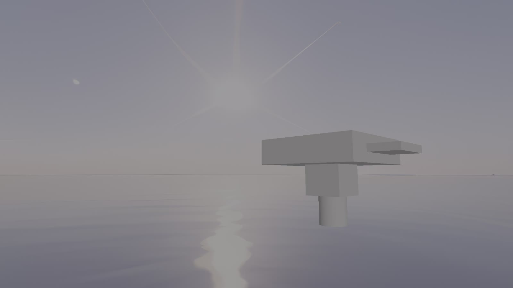
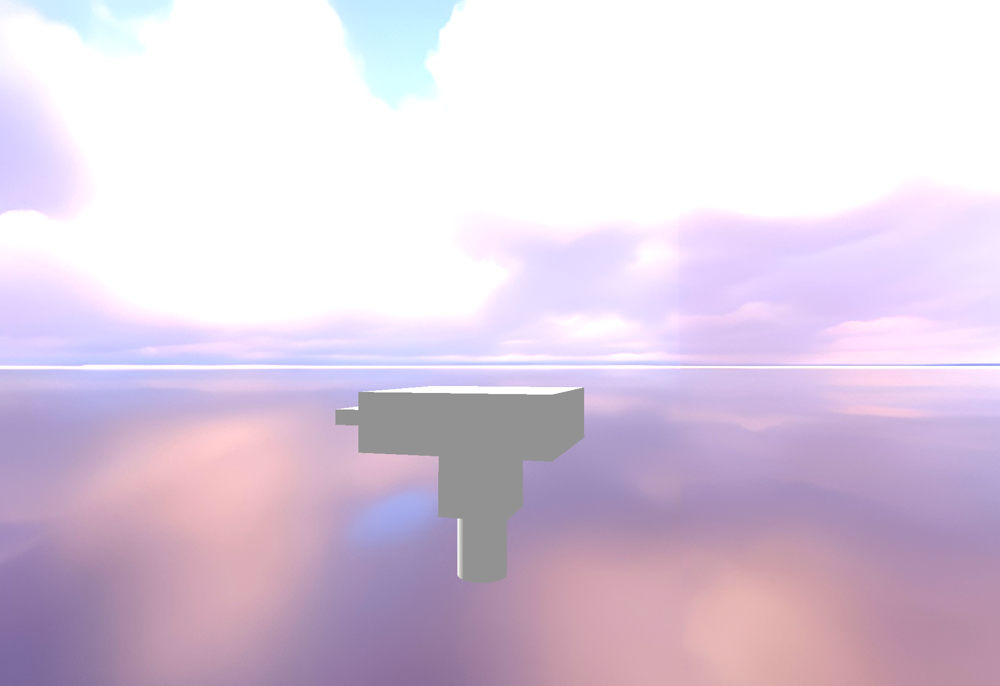

# Vulkan 3D Renderer

A modern real-time 3D rendering application written in **C++20** using **Vulkan 1.4** and developed with **Visual Studio 2026**. The renderer combines a **hybrid deferred/forward architecture**, **Forward+ / clustered lighting**, physically based rendering (PBR), image-based lighting (IBL), shadow mapping, glTF/GLB materials, and a growing collection of screen-space and temporal rendering techniques: **GTAO, motion vectors, TAA, SSR, and SSGI**.

> **Development status:** These rendering systems are implemented in the source code, but the complete Windows build, GLSL/SPIR-V validation, and Vulkan GPU runtime acceptance have **not yet been verified** in the supplied development environment. **SSGI is opt-in and disabled by default** pending GPU validation. Other features may depend on the selected render path, GPU capabilities, and runtime configuration.

## Features

### Core rendering

- **Vulkan 1.4** renderer written in **C++20**.
- **Visual Studio 2026** solution and project.
- **Hybrid rendering architecture** with deferred lighting, forward rendering, and custom rendering paths.
- **Forward+ / clustered lighting** and light culling for multiple local lights.
- **RenderGraph-based pass organization**, image usage tracking, and Vulkan resource transitions.
- **Custom rendering pipelines and shaders** for scene-specific effects.
- **HDR rendering**, final composition, and tonemapping.
- **Shadow mapping** for supported light types, including local-light shadows.
- **Physically Based Rendering (PBR)** using the metallic-roughness workflow.
- **Environment lighting / image-based lighting (IBL)**, including diffuse and specular contributions, HDR environments, and BRDF-based reflections.
- **Skybox rendering** with environment/cubemap textures.

### Screen-space lighting and temporal effects

- **GTAO (Ground-Truth Ambient Occlusion)**, including spatial denoising and integration with supported deferred and forward/custom rendering paths.
- **Motion vectors / velocity buffers** for camera motion and scene geometry, including dedicated handling for moving and deformed/skinned geometry where supported.
- **TAA (Temporal Anti-Aliasing)** with motion-vector reprojection, history accumulation, neighborhood constraints, depth-history disocclusion checks, and handling for sky and transparent surfaces.
- **SSR (Screen-Space Reflections)** with screen-space ray tracing, temporal stabilization, depth/disocclusion validation, and composition with specular IBL.
- **SSGI (Screen-Space Global Illumination)** with stochastic screen-space tracing, hit confidence, motion-vector-based temporal reprojection, adaptive history blending, edge-aware spatial denoising, and diffuse-IBL-aware composition.
- **History ping-pong and invalidation** for temporal effects, including handling of unavailable TAA history and submission-aware history state updates.

### Assets, materials, and interaction

- **glTF and GLB model/material importing** using Assimp.
- **PBR material textures:** base color, metallic-roughness, tangent-space normal, ambient occlusion, and emissive maps.
- **Material factors:** base color, metallic, roughness, and emissive properties.
- **Custom mesh loading** and external geometry.
- **Texture loading and mapping** using stb_image.
- **Real-time camera movement** and interactive input.
- **GLM** for vector, matrix, and transformation mathematics.
- **GLFW3** for window creation, input, and Vulkan surface management.

### Diagnostics and validation infrastructure

- **Vulkan Validation Layers** support with `VK_EXT_debug_utils` diagnostics.
- Optional **Synchronization Validation** via the `VULKAN_SYNC_VALIDATION=1` environment variable (requires suitable Vulkan SDK/layers).
- Static regression checks for GTAO, IBL, TAA, SSR, and SSGI development milestones.
- Shader compilation and SPIR-V validation scripts, plus an SSGI release-acceptance workflow.
- Explicit checks for selected Vulkan API failures and temporal-history state transitions.

## Screenshots

### Frame 1



### Frame 2



> Screenshot links are preserved from the original README. Ensure the corresponding files exist in `screenshots/` when publishing the repository.

## Technology Stack

| Technology | Purpose |
|---|---|
| **C++20** | Core programming language |
| **Vulkan 1.4** | Low-level graphics and rendering API |
| **GLFW3** | Window creation, input, and Vulkan surface handling |
| **GLM** | Mathematics, vectors, matrices, and transformations |
| **Assimp** | 3D model importing, including glTF and GLB |
| **stb_image** | Image loading and texture processing |
| **GLSL / SPIR-V** | GPU shaders and Vulkan shader modules |
| **Vulkan SDK tools** | Shader compilation (`glslc`), SPIR-V validation (`spirv-val`), and validation layers |
| **Visual Studio 2026** | Development environment |

The project targets modern versions of the graphics libraries and development tools.

## Rendering Features

### Hybrid Rendering and RenderGraph

The renderer combines deferred and forward rendering techniques, allowing different geometry, lighting, and custom rendering passes to contribute to a shared HDR frame. A RenderGraph organizes pass dependencies and image usage. Screen-space effects are composed in a defined order before final presentation.

### Forward+ Rendering and Clustered Lighting

Forward+ rendering uses light culling to identify relevant lights for scene regions, reducing unnecessary per-fragment lighting work and supporting scenes with multiple light sources. The renderer also includes a deferred lighting path.

### Custom Rendering

Custom pipelines and shaders provide control over rendering passes, material appearance, lighting calculations, and other graphics effects. Integration of custom/forward geometry is considered in the ambient-occlusion and temporal-rendering paths.

### Physically Based Rendering (PBR)

The renderer supports a metallic-roughness PBR workflow designed to produce consistent, material-dependent lighting under different illumination conditions.

Supported material properties include:

- Base color and base-color textures
- Metallic and roughness factors
- Metallic-roughness textures
- Tangent-space normal maps
- Ambient occlusion
- Emissive color and textures

### Image-Based Lighting (IBL) and HDR

Environment lighting complements local light sources with **diffuse irradiance** and **specular environment reflections**. The rendering path includes HDR lighting and BRDF-related processing. Diffuse IBL and specular IBL are exposed separately where needed so that SSGI and SSR can blend with the appropriate environment-lighting contribution rather than simply adding light on top of it.

### GTAO — Ground-Truth Ambient Occlusion

GTAO estimates ambient occlusion from scene depth and geometry, then applies edge-aware filtering to reduce noise and preserve depth boundaries. It is integrated with the lighting pipeline and includes support for relevant forward/custom paths. GTAO is an occlusion effect, not a substitute for indirect bounce lighting.

### Motion Vectors

Dedicated motion-vector passes describe pixel movement between frames. They account for camera reprojection and supported moving geometry, including geometry/deformation-related paths. Motion vectors are consumed by temporal effects such as TAA, SSR, and SSGI.

### TAA — Temporal Anti-Aliasing

TAA combines the current HDR frame with reprojected history to reduce temporal aliasing and shimmer. The implementation includes depth-history checks to reject disoccluded pixels, neighborhood/history constraints, camera/sky reprojection, and special handling for transparency and reactive regions. History validity is managed across resets and frame submissions.

### SSR — Screen-Space Reflections

SSR traces reflection rays against visible scene depth, estimates reflection confidence, and uses temporal reprojection to stabilize the result. The composite integrates SSR with **specular IBL**, reducing double-counting of reflected light. Like other screen-space methods, SSR cannot reflect geometry that is absent from the visible depth buffer.

### SSGI — Screen-Space Global Illumination

SSGI traces stochastic rays through the visible scene to estimate **diffuse indirect lighting** from screen-space radiance. Its pipeline includes:

1. **SSGI Trace:** Screen-space ray marching and hit-confidence estimation.
2. **SSGI Temporal:** Motion-vector reprojection, depth-history validation, and adaptive history blending.
3. **SSGI Spatial Denoise:** Edge-aware filtering using depth and surface information.
4. **SSGI Diffuse Combine:** Material-aware composition with diffuse IBL to limit double-counting.

SSGI shares temporal infrastructure with TAA and is **disabled by default** (`ssgiTraceEnabled = false`) until runtime GPU acceptance is completed. Because it is a screen-space technique, off-screen geometry and hidden surfaces cannot contribute reliably.

### glTF and GLB Material Loading

The renderer imports 3D models and their material properties from glTF and GLB assets. PBR textures and material factors can be used to reproduce the appearance intended by the original asset.

### Shadow Mapping

Shadow mapping provides depth-based shadow information for objects illuminated by supported light sources, including local-light shadow paths, adding depth and spatial definition to the scene.

### Custom Meshes

The renderer loads custom 3D meshes, allowing scenes to be built from external geometry rather than being limited to predefined primitives.

### Shaders

Custom Vulkan GLSL shaders provide flexibility for implementing rendering techniques, material effects, and lighting models. The project includes dedicated shaders for deferred lighting, Forward+, shadows, GTAO, motion vectors, TAA, SSR, SSGI, skybox rendering, and composition.

### Camera Movement

The camera can be moved through the 3D environment in real time, allowing the scene to be inspected from different perspectives.

### Texturing

Textures provide surface detail and material information. Depending on the material, they can control color, roughness, metallic response, surface normals, ambient occlusion, and emission.

### Skybox

A cubemap-based skybox surrounds the scene with an environment texture, providing a background for the rendered world and supporting environment-based illumination.

## Typical Rendering Pipeline

The exact passes depend on configuration and render path. A representative frame is:

1. Process input, update the camera, and prepare scene/object transforms.
2. Prepare material textures, lighting, and shadow data.
3. Perform Forward+ / clustered light culling where applicable.
4. Render shadow maps and scene geometry / G-buffer data.
5. Evaluate GTAO and filter ambient occlusion.
6. Perform deferred/forward PBR lighting with HDR and IBL contributions.
7. Generate camera and geometry motion vectors.
8. Trace SSR, temporally stabilize it, and composite specular reflections.
9. **If enabled**, trace SSGI, temporally stabilize it, denoise it, and combine diffuse indirect lighting.
10. Resolve TAA using motion vectors and depth/history validation.
11. Apply final HDR composition / tonemapping and render the final image.
12. Present the swapchain image.

## Vendors

The project includes or uses the following dependencies in its `vendors` directory:

- **Assimp**
- **GLFW3**
- **GLM**
- **stb_image**

## Requirements

To build and run the project, you need:

- **Visual Studio 2026** with a C++20-capable compiler
- **Vulkan SDK 1.4**
- A GPU and driver supporting the Vulkan features required by the selected rendering paths
- Required third-party dependencies and runtime assets
- For shader validation: **`glslc`** and **`spirv-val`** from the Vulkan SDK
- For runtime diagnostics: **`VK_LAYER_KHRONOS_validation`** and compatible validation-layer extensions

Make sure the Vulkan SDK and required dependencies are correctly installed and configured in the build environment.

## Build

1. Open **`Vulkan3DRenderer.slnx`** in Visual Studio 2026.
2. Select the appropriate configuration and platform.
3. Ensure the Vulkan SDK, compiler, and vendored dependencies are configured.
4. Compile the project and make sure the runtime assets are available at the expected paths.
5. Run the application on a compatible Vulkan GPU.

Before running the application, make sure that:

1. Your GPU supports the required Vulkan features.
2. Your Vulkan drivers are up to date.
3. The Vulkan SDK is installed and configured.
4. All required dependencies are available.
5. Runtime assets, including meshes, textures, shaders, and skybox textures, are available at the expected paths.

### Shader and SSGI validation

From the project root, run the static SSGI checks:

```bash
python validate_ssgi_release.py
```

For strict shader compilation and SPIR-V validation on Windows:

```bat
ssgi_release_acceptance.bat
```

To enable synchronization diagnostics in a Windows Command Prompt before launching the renderer:

```bat
set VULKAN_SYNC_VALIDATION=1
```

See the phase-specific `README_*.md` documents and the GPU acceptance checklist for additional test scenarios. **Passing static tests is not equivalent to passing shader compilation, a Windows build, or GPU runtime validation.**

## Project Overview

The renderer follows a Vulkan-based architecture combining GPU resources, RenderGraph passes, shaders, meshes, materials, lighting, shadows, environment illumination, camera transformations, and temporal history to produce the final image. The project has progressed from basic real-time rendering to a hybrid HDR pipeline with GTAO, TAA/motion vectors, SSR, and experimental SSGI.

## Current Validation Status

| Area | Status |
|---|---|
| Core renderer, PBR, glTF/GLB, shadows, and Forward+ | Implemented in source |
| GTAO and denoising | Implemented in source |
| Motion vectors and TAA | Implemented in source |
| SSR and specular-IBL composition | Implemented in source |
| SSGI, temporal denoising, and diffuse-IBL composition | Implemented in source; **opt-in** |
| Static regression and release checks | Available |
| Vulkan debug messenger and optional synchronization validation | Integrated in source |
| Full GLSL/SPIR-V validation | **Pending local SDK execution** |
| Full Visual Studio / Windows build | **Pending verification** |
| Vulkan GPU runtime and performance acceptance | **Pending verification** |
